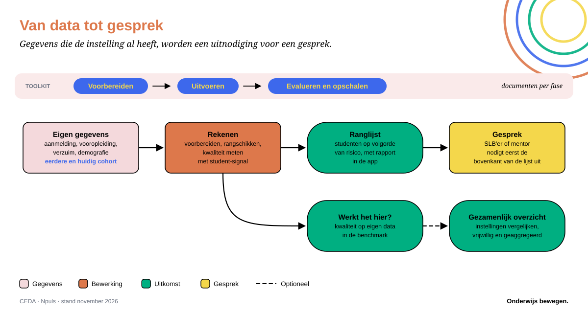

#  De Uitnodigingsregel

*Van data tot gesprek*

Een deel van de mbo-studenten valt in het eerste jaar uit. Begeleiders willen die studenten op tijd spreken, maar kunnen niet iedereen tegelijk zien. De Uitnodigingsregel helpt bepalen met wie ze als eerste in gesprek gaan.

## Wat is de Uitnodigingsregel

De Uitnodigingsregel maakt een ranglijst van studenten, op volgorde van het risico dat ze uitvallen. De lijst is gebaseerd op gegevens die de instelling al heeft: aanmelding, vooropleiding, verzuim in de eerste tien weken en een paar persoonskenmerken. Een model leert van eerdere jaren welke studenten uitvielen en past dat toe op het huidige jaar.

SLB'ers en mentoren nodigen studenten uit vanaf de bovenkant van de lijst. Vandaar de naam. De lijst is een signaal, geen oordeel: de begeleider beslist met wie en waarover het gesprek gaat.

De methode komt uit het [promotieonderzoek van Irene Eegdeman](https://research.vu.nl/en/publications/enhancing-study-success-in-dutch-vocational-education) (ROC TOP). Bij zes instellingen is de methode wetenschappelijk gerepliceerd op data van eerdere jaren en gepubliceerd. Daarna volgden [praktijkpilots](https://datagedrevenonderzoekmbo.nl/themas/uitnodigingsregel/evaluatie-van-de-eerste-praktijkpilot-voor-de-uitnodigingsregel/) bij mbo-instellingen. Nu is er een [app](https://github.com/cedanl/Uitnodigingsregel) die een instelling zelf installeert en draait.

## Van data tot gesprek

  

In de praktijk zijn het zeven stappen, die elk jaar terugkomen:

1. **Voorbereiden** binnen de instelling: [draagvlak](http://datagedrevenonderzoekmbo.nl/wp-content/uploads/2026/03/De-Uitnodigingsregel-Draagvlak-binnen-de-instelling.pdf), [afspraken](http://datagedrevenonderzoekmbo.nl/wp-content/uploads/2026/03/De-Uitnodigingsregel-Spelregels-.pdf) over wie de lijst ziet en wat er met een signaal gebeurt.
2. **Data verzamelen** uit het studentinformatiesysteem: eerdere jaren en het huidige jaar. Zie [Data en bronnen](docs/data-en-bronnen.md).
3. **Analyse draaien** in de [app](https://cedanl.github.io/Uitnodigingsregel/aan-de-slag/).
4. **Kwaliteit bekijken** in het rapport. Een stoplicht laat zien hoe goed het model op de eigen data voorspelt. Dat helpt bij de keuze hoe je de lijst inzet ([resultaten lezen](https://cedanl.github.io/Uitnodigingsregel/resultaten-lezen/)).
5. **Ranglijst delen** met de begeleiders die de gesprekken voeren.
6. **Gesprek voeren** met de student.
7. **Terugkijken** aan het eind van het jaar met het [template evaluatie](http://datagedrevenonderzoekmbo.nl/wp-content/uploads/2026/03/Business-Case-en-pilot-evaluatie-Uitnodigingsregel.pdf) en het nieuwe cohort toevoegen.

Per stap meer uitleg: [Van data tot gesprek](https://cedanl.github.io/Uitnodigingsregel/van-data-tot-gesprek/).

## Wat er is

  

### Toolkit

Documenten voor de invoering, gebaseerd op de ervaringen uit de pilots, en een e-learningmodule. Alle documenten staan in de [Toolkit Uitnodigingsregel](https://datagedrevenonderzoekmbo.nl/toolkit-uitnodigingsregel/).

| Fase | Documenten |
|---|---|
| Voorbereiden | [Draagvlak binnen de instelling](http://datagedrevenonderzoekmbo.nl/wp-content/uploads/2026/03/De-Uitnodigingsregel-Draagvlak-binnen-de-instelling.pdf), [Route naar de praktijk](http://datagedrevenonderzoekmbo.nl/wp-content/uploads/2026/03/De-Uitnodigingsregel-Route-naar-de-praktijk.pdf), [Plan van aanpak pilot](http://datagedrevenonderzoekmbo.nl/wp-content/uploads/2026/03/De-Uitnodigingsregel-Plan-van-aanpak-deelname-praktijk-pilot-1.pdf), [Kwaliteit van het model](http://datagedrevenonderzoekmbo.nl/wp-content/uploads/2026/03/De-Uitnodigingsregel-Kwaliteit-van-het-model-1.pdf), [Spelregels](http://datagedrevenonderzoekmbo.nl/wp-content/uploads/2026/03/De-Uitnodigingsregel-Spelregels-.pdf), [Het ethische gesprek](http://datagedrevenonderzoekmbo.nl/wp-content/uploads/2026/03/De-Uitnodigingsregel-Het-ethische-gesprek.pdf), [Literatuuroverzicht en interventies](http://datagedrevenonderzoekmbo.nl/wp-content/uploads/2026/03/De-Uitnodigingsregel-Literatuuroverzicht-en-interventies.pdf), [Het eenduidige verhaal](http://datagedrevenonderzoekmbo.nl/wp-content/uploads/2026/03/De-Uitnodigingsregel-Het-eenduidige-verhaal.pdf) |
| Uitvoeren | Uitlegvideo [Wat is de Uitnodigingsregel?](https://datagedrevenonderzoekmbo.nl/wp-content/uploads/Toolkit/Uitlegvideo_Algemeen.pptx) en [Ethiek en spelregels](https://datagedrevenonderzoekmbo.nl/wp-content/uploads/Toolkit/Uitlegvideo_Ethiek.pptx) (PowerPoint), handleidingen voor teams |
| Evalueren en opschalen | [Template evaluatie en business case](http://datagedrevenonderzoekmbo.nl/wp-content/uploads/2026/03/Business-Case-en-pilot-evaluatie-Uitnodigingsregel.pdf), [Checklist opschalen na de pilot](http://datagedrevenonderzoekmbo.nl/wp-content/uploads/2026/03/De-Uitnodigingsregel-Checklist-opschalen-na-de-pilot.pdf) |

### Tools

- **[De app](https://github.com/cedanl/Uitnodigingsregel)** maakt de ranglijst en een rapport over datakwaliteit en modelkwaliteit. Je klikt, je programmeert niet.
- **[De benchmark](https://github.com/cedanl/uitnodigingsregel-benchmark)** laat zien of het model op de data van je instelling goed genoeg werkt, en welke gegevens daaraan bijdragen. Je kunt de uitkomst delen en vergelijken met andere instellingen.
- **[student-signal](https://github.com/cedanl/student-signal)** is de rekenkern als library, voor ontwikkelaars die in eigen code willen rekenen.

De app en de benchmark rekenen allebei met student-signal. Een uitkomst in de benchmark is dus te vergelijken met wat de app laat zien.

### Ondersteuning

CEDA helpt instellingen die willen starten:

- een **informatiesessie** voor je team over de methode en de mogelijkheden;
- hulp om de **data op orde** te krijgen: bepalen welke gegevens nodig zijn, ophalen en klaarzetten;
- **twee dagen op locatie** met een data scientist van CEDA. Dag 1: data verzamelen en klaarzetten met de SQL-voorbeelden en de variabelenlijst. Dag 2: het model draaien op eigen data en de uitkomst leren lezen;
- **meedenken over financiering**, bijvoorbeeld als maatregel binnen het regionaal programma vsv;
- contact met **instellingen die al pilots draaiden**.

Interesse? Zie [Contact](#contact).

## Aan de slag

Kies de situatie die bij je past.

1. **We oriënteren ons.** Lees [Het eenduidige verhaal](http://datagedrevenonderzoekmbo.nl/wp-content/uploads/2026/03/De-Uitnodigingsregel-Het-eenduidige-verhaal.pdf), bekijk de [demo-video van de app](https://github.com/cedanl/Uitnodigingsregel#demo) en vraag een informatiesessie aan.
2. **We willen weten of het op onze data werkt.** Zet de gegevens klaar met de [variabelenlijst](https://github.com/cedanl/Uitnodigingsregel/blob/main/docs/Variabelen_Definities_v4.xlsx) en de [SQL-voorbeelden](https://github.com/cedanl/Uitnodigingsregel_datapreparatie) en draai de [benchmark](https://github.com/cedanl/uitnodigingsregel-benchmark). Liever samen? Vraag de twee dagen op locatie aan.
3. **We starten een pilot.** Werk de toolkit door voor de voorbereiding, installeer de [app](https://cedanl.github.io/Uitnodigingsregel/aan-de-slag/) en gebruik de handleidingen voor teams.
4. **We willen evalueren of opschalen.** Gebruik het [template evaluatie en business case](http://datagedrevenonderzoekmbo.nl/wp-content/uploads/2026/03/Business-Case-en-pilot-evaluatie-Uitnodigingsregel.pdf) en de [checklist opschalen](http://datagedrevenonderzoekmbo.nl/wp-content/uploads/2026/03/De-Uitnodigingsregel-Checklist-opschalen-na-de-pilot.pdf), en deel je uitkomst in het [gezamenlijke overzicht](https://cedanl.github.io/uitnodigingsregel-benchmark/).
5. **We willen zelf bouwen of onderzoek doen.** Begin met de [broncode van de app](https://github.com/cedanl/Uitnodigingsregel). Wil je in eigen code rekenen, gebruik dan [student-signal](https://cedanl.github.io/student-signal/), de library waarmee de app rekent.

## Overzicht van de tools

<table>
<tr><th align="left" width="18%">Tool</th><th align="left" width="18%">Voor wie</th><th align="left" width="24%">Wat gaat erin</th><th align="left" width="24%">Wat komt eruit</th><th align="left" width="16%">Begin hier</th></tr>
<tr>
<td valign="top"><a href="https://github.com/cedanl/Uitnodigingsregel">Uitnodigingsregel</a> (app)</td>
<td valign="top">BI-medewerkers en data scientists. De ranglijst is voor SLB'ers en mentoren.</td>
<td valign="top">Gegevens van eerdere jaren, met wie er uitviel, en van het huidige jaar.</td>
<td valign="top">Ranglijst per model. Rapport over datakwaliteit en modelkwaliteit.</td>
<td valign="top"><a href="https://cedanl.github.io/Uitnodigingsregel/aan-de-slag/">Aan de slag</a></td>
</tr>
<tr>
<td valign="top"><a href="https://github.com/cedanl/uitnodigingsregel-benchmark">uitnodigingsregel-benchmark</a></td>
<td valign="top">Instellingen die willen weten of de methode bij hen werkt.</td>
<td valign="top">Gegevens van eerdere jaren, met wie er uitviel.</td>
<td valign="top">Hoe goed modellen voorspellen en welke gegevens bijdragen. Rapport en een bestand om te delen.</td>
<td valign="top"><a href="https://github.com/cedanl/uitnodigingsregel-benchmark#installeren">Installeren</a></td>
</tr>
<tr>
<td valign="top"><a href="https://github.com/cedanl/student-signal">student-signal</a></td>
<td valign="top">Ontwikkelaars die in eigen code rekenen.</td>
<td valign="top">Een tabel met studentgegevens, in eigen code.</td>
<td valign="top">Voorbereide data, ranglijst en kwaliteitsmaten.</td>
<td valign="top"><a href="https://cedanl.github.io/student-signal/">Documentatie</a></td>
</tr>
</table>

### Hoe de tools met gegevens omgaan

- De tools draaien op een computer van de instelling. Er gaan geen studentgegevens naar CEDA of naar een server.
- Delen kan alleen met de benchmark, en alleen als de instelling dat wil. Wat gedeeld wordt, zijn uitkomsten per instelling, geen gegevens van studenten.
- Elke tool heeft demodata, zodat je hem kunt bekijken zonder echte gegevens.

## Data en bronnen

De tools gebruiken alleen gegevens van de instelling zelf, uit het studentinformatiesysteem. Welke gegevens dat zijn, hoe je ze klaarzet en waar je meer leest over de methode: zie [Data en bronnen](docs/data-en-bronnen.md).

## Waar we heen willen

1. **Mbo:** van pilots naar een vast programma, met extra instellingen.
2. **Hbo en wo:** de methode verkennen.
3. **Online demo:** de Uitnodigingsregel leren kennen zonder iets te installeren.

Uitgewerkt in [Waar we heen willen](docs/richting.md).

## Presentaties

| Datum | Titel | Over |
|---|---|---|
| 30 september 2026 | [De Uitnodigingsregel](https://github.com/cedanl/clidev-presentaties/blob/main/exports/260930_uitnodigingsregel.pdf) | Wat de methode is, wat er al ligt en wat CEDA voor een instelling kan doen |
| 30 september 2026 | [Vroegtijdig signaleren van studentuitval](https://github.com/cedanl/clidev-presentaties/blob/main/exports/20260930_Uitnodigingsregel_stavaza.pdf) | Stand van zaken: toolkit, pilots, de app en de vervolgstappen voor 2026-2027 |

## Documentatie

- Hoe goed werkt het: [kwaliteit meten en wat de pilots lieten zien](docs/hoe-goed-werkt-het.md)
- App: [cedanl.github.io/Uitnodigingsregel](https://cedanl.github.io/Uitnodigingsregel/)
- student-signal: [cedanl.github.io/student-signal](https://cedanl.github.io/student-signal/)
- Benchmark: [README](https://github.com/cedanl/uitnodigingsregel-benchmark#readme) en [gezamenlijk overzicht](https://cedanl.github.io/uitnodigingsregel-benchmark/)

## Contact

Vragen, een informatiesessie of de twee dagen op locatie aanvragen?

- E-mail: [ceda@surf.nl](mailto:ceda@surf.nl)
- Community: [CEDA op de Data & AI-community van Npuls](https://community-data-ai.npuls.nl/groups/view/44d20066-53a8-48c2-b4e9-be348e05d273/project-center-for-educational-data-analytics-ceda)
- GitHub: [github.com/cedanl](https://github.com/cedanl)
